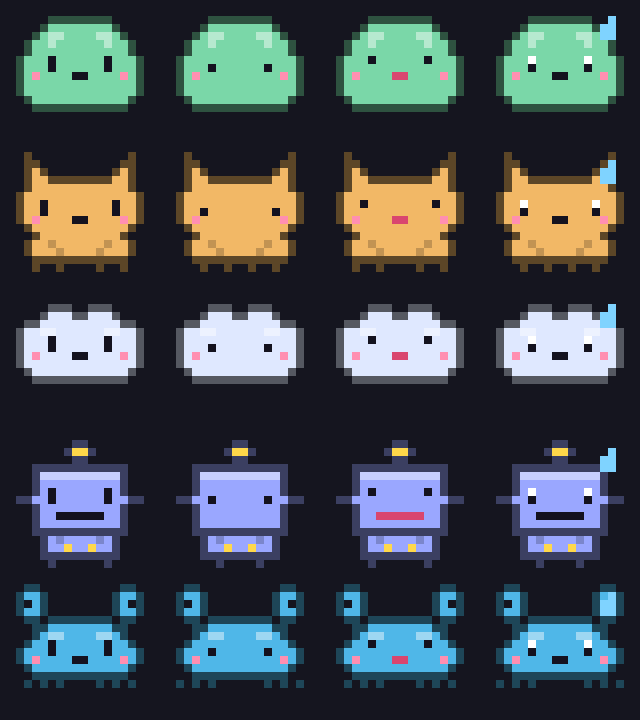

# Scuttle 🐾

A cosy code editor for macOS with GitHub built in, and little pixel pets that crawl around your screen while you code.



## Start it

```bash
npm install
npm start
```

## What's inside

- **Editor**: Monaco (the same editor engine VS Code uses), tabs, syntax highlighting for lots of languages, dark theme.
- **Explorer**: open a folder, new file / folder, rename, move to Trash (right-click a file).
- **Search**: search in every file of the folder (`⌘⇧F`), quick open a file (`⌘P`).
- **Terminal**: a real terminal at the bottom (`⌃\``).
- **Source Control**: see changed files, commit, push, pull, or publish a folder as a new GitHub repo.
- **GitHub account**: sign in with GitHub, see your avatar, list and clone your repos.
- **Coding pets**: type steadily for a couple of minutes and a buddy shows up.
  - 5 original pets: **Gloop** the blob, **Biscuit** the cat, **Puff** the cloud, **Bolt** the robot, **Pinch** the crab.
  - Pick the pet, its colour, name, size, and how long you have to type before it comes.
  - It walks along the bottom, climbs up the walls and crawls upside down on the ceiling.
  - It sleeps (`z z z`) when you stop typing, is happy when you save, panics at errors and cheers when you push.
  - **Pop out**: tick "crawl across my whole desktop" and it crawls around your whole Mac screen. Right-click it to send it back.
  - Click your pet to pet it. `⌘⇧K` summons it right away.

## GitHub sign-in (one-time setup)

Scuttle uses GitHub's *device flow*: GitHub shows you a short code in your browser, you type it in, done.
Scuttle never sees your password. The sign-in token is encrypted with a key kept in your macOS Keychain.

1. Go to <https://github.com/settings/applications/new>.
2. **Application name**: `Scuttle`
3. **Homepage URL**: your GitHub profile URL
4. **Authorization callback URL**: `http://127.0.0.1/callback` (not used, but GitHub requires one)
5. Tick ✅ **Enable Device Flow**, then click **Register application**.
6. Copy the **Client ID** (you do *not* need a client secret).
7. In Scuttle, click the GitHub icon on the left, paste the Client ID and click **Save**.
   (Or paste it into `config.json` next to this README.)
8. Click **Sign in with GitHub** 🎉

A Client ID is not a secret, so it's fine for it to be in `config.json`.

## Made with

Electron, Monaco Editor, xterm.js and node-pty (all MIT licensed). The pets are original pixel art drawn in code
(`renderer/pets.js`), so you can add your own: draw the left half of the sprite and Scuttle mirrors it.

MIT License.
